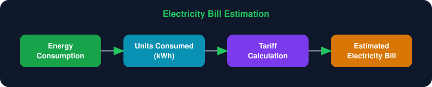
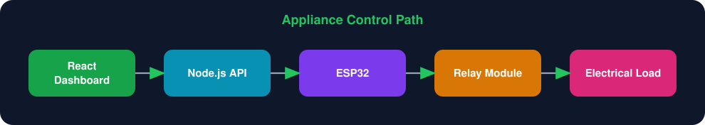
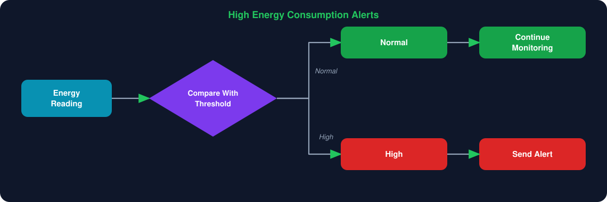
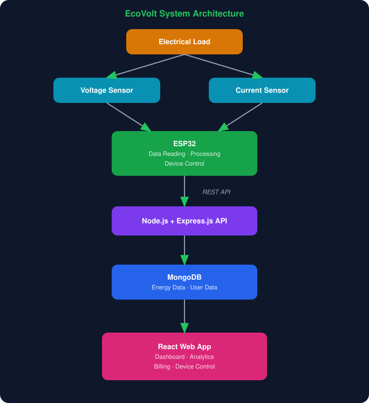
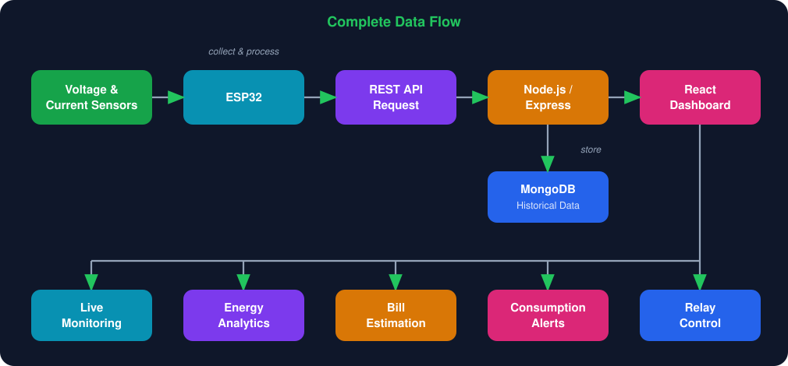
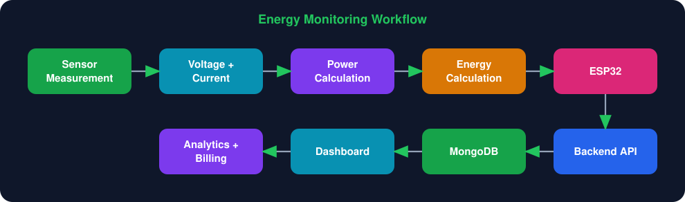
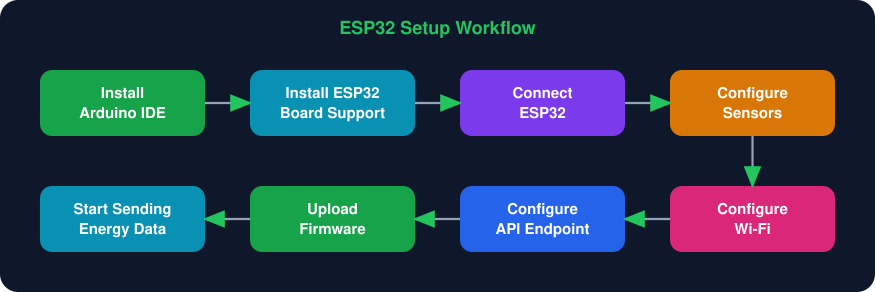
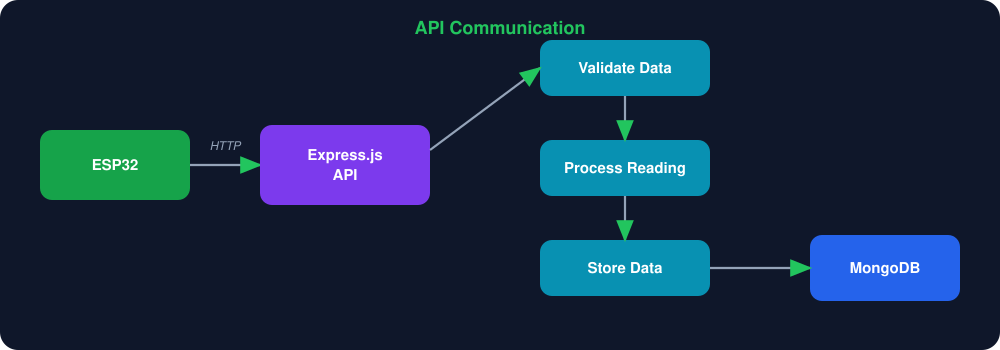
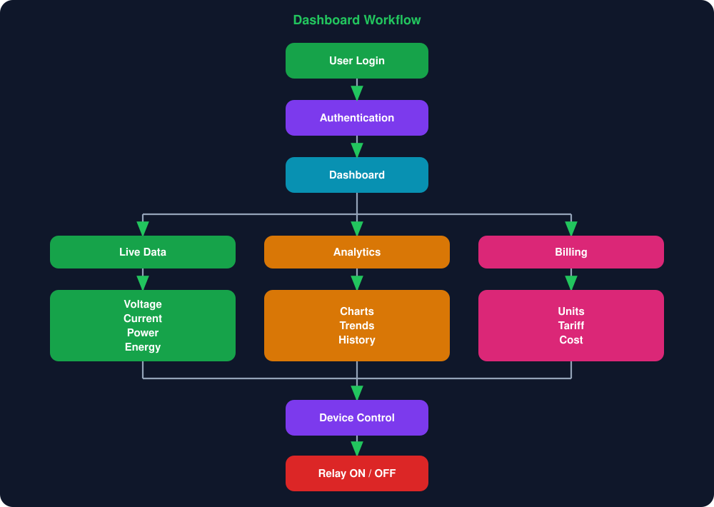
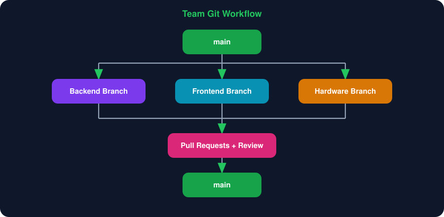

<div align="center">

# ⚡ EcoVolt — Secure IoT Smart Energy Meter

**Monitor. Analyze. Optimize. Save Energy. 🌱**

An IoT-powered smart energy monitoring and billing system that tracks electricity consumption in real time, analyzes usage patterns, controls electrical loads, and presents insights through a modern web dashboard.

<p>


</p>

<p>


</p>

</div>

---

## 📑 Table of Contents

- [Overview](#-overview)
- [Project Objectives](#-project-objectives)
- [Key Features](#-key-features)
- [System Architecture](#-system-architecture)
- [Hardware Components](#-hardware-components)
- [Software Stack](#-software-stack)
- [Project Structure](#-project-structure)
- [Getting Started](#-getting-started)
- [ESP32 Setup](#-esp32-setup)
- [API Communication](#-api-communication)
- [Dashboard Workflow](#-dashboard-workflow)
- [Security Considerations](#-security-considerations)
- [Energy Calculation](#-energy-calculation)
- [Future Enhancements](#-future-enhancements)
- [Team Collaboration](#-team-collaboration)
- [Safety Notice](#%EF%B8%8F-safety-notice)
- [Contact](#-contact)

---

## 📌 Overview

**EcoVolt** is a full-stack IoT smart energy monitoring platform that combines electrical sensors, an ESP32 microcontroller, backend services, and a modern web dashboard.

The system collects **voltage, current, power, and energy consumption** data from connected electrical loads. The ESP32 processes the sensor readings and sends them to the backend server through a REST API. Users can then monitor consumption on an interactive React dashboard, analyze usage patterns, estimate electricity costs, and switch connected loads ON or OFF through a relay module.

| | |
|---|---|
| ⚡ IoT hardware | 🔌 Electrical sensors |
| 🧠 ESP32 embedded programming | 🌐 REST API communication |
| ⚛️ React web development | 📊 Data visualization |
| 🗄️ MongoDB database | 🔐 Authentication & security |
| 💰 Billing & analytics | 🚨 Consumption alerts |

---

## 🎯 Project Objectives

- Monitor electricity consumption in real time.
- Measure voltage and current from electrical loads.
- Calculate electrical power and energy usage.
- Store energy data for historical analysis.
- Display live readings on a web dashboard.
- Estimate electricity bills from energy consumption.
- Provide graphical analytics of consumption.
- Control appliances using a relay module.
- Detect unusually high energy consumption.
- Lay a foundation for future cloud and AI-based energy management.

---

## ✨ Key Features

### ⚡ Real-Time Energy Monitoring

Track voltage, current, power, energy consumption, and connected load status. The ESP32 collects the readings and sends them to the backend for processing and storage.

### 📊 Interactive Dashboard

A centralized React interface showing current readings, historical consumption, power usage, energy trends, estimated cost, device status, and relay status.

### 💰 Electricity Bill Estimation

Energy usage is converted into units (kWh) and billed according to the configured tariff rates.

<p align="center">
  
</p>

### 🔌 Appliance Control

A relay module connected to the ESP32 lets users switch loads ON or OFF straight from the dashboard.

<p align="center">
  
</p>

### 🚨 High Energy Consumption Alerts

Readings are compared against configured thresholds; high usage triggers an alert while normal usage continues to be monitored.

<p align="center">
  
</p>

### 📈 Energy Analytics

Historical readings help identify high-consumption periods, daily usage patterns, trends, power variations, and opportunities to save energy.

### 🔐 Secure Application Access

Protected dashboard functionality is available only to authenticated users, supported by protected routes, backend request validation, environment variables, database access protection, and API security.

---

## 🏗️ System Architecture

<p align="center">
  
</p>

### 🔄 Complete Data Flow

<p align="center">
  
</p>

### 📈 Energy Monitoring Workflow

<p align="center">
  
</p>

---

## 🔌 Hardware Components

| Component | Purpose |
| --- | --- |
| **ESP32** | Main IoT microcontroller |
| **Voltage Sensor** | Measures electrical voltage |
| **Current Sensor** | Measures electrical current |
| **Relay Module** | Switches connected electrical loads |
| **Electrical Load** | Device/appliance being monitored |
| **Connecting Wires** | Hardware connections |
| **Power Supply** | Powers the electronics |

---

## 💻 Software Stack

| Category | Technology |
| --- | --- |
| Microcontroller | ESP32 |
| Embedded Development | Arduino IDE |
| Frontend | React, Tailwind CSS, Vite |
| Data Visualization | Chart.js |
| Backend | Node.js, Express.js |
| Database | MongoDB |
| Communication | REST API |
| Version Control | Git & GitHub |

---

## 📂 Project Structure

```text
EcoVolt-Smart-Sustainable-Energy/
├── frontend/
│   ├── public/
│   ├── src/
│   │   ├── components/
│   │   ├── pages/
│   │   ├── services/
│   │   ├── hooks/
│   │   ├── assets/
│   │   └── App.jsx
│   └── package.json
├── backend/
│   ├── routes/
│   ├── controllers/
│   ├── models/
│   ├── middleware/
│   ├── config/
│   ├── index.js
│   └── package.json
├── hardware/
│   └── esp32/
├── docs/
│   └── images/          # README diagrams
├── README.md
└── .gitignore
```

> The exact folders may vary with the current implementation.

---

## 🚀 Getting Started

### Prerequisites

- [Node.js](https://nodejs.org/) (LTS) and npm
- MongoDB (local install or MongoDB Atlas)
- Arduino IDE with ESP32 board support
- Git

### 1. Clone the repository

```bash
git clone https://github.com/gundatejeswararao7/EcoVolt-Smart-Sustainable-Energy.git
cd EcoVolt-Smart-Sustainable-Energy
```

### 2. Backend setup

```bash
cd backend
npm install
```

Create a `.env` file in `backend/`:

```env
MONGODB_URI=your_mongodb_connection_string
PORT=5000
JWT_SECRET=your_secret_key
```

> ⚠️ **Never commit `.env` files or database credentials to GitHub.** Make sure `.gitignore` contains:
>
> ```text
> .env
> node_modules/
> ```

Start the server:

```bash
node index.js
```

### 3. Frontend setup

Open a new terminal:

```bash
cd frontend
npm install
npm run dev
```

The React app is served by the local Vite development server (the URL is printed in the terminal).

---

## 🔧 ESP32 Setup

Firmware is developed and uploaded with the Arduino IDE.

<p align="center">
  
</p>

Once running, the ESP32 collects sensor readings and sends them to the backend API.

---

## 🔗 API Communication

EcoVolt follows a client-server architecture. The ESP32 posts readings to the Express API, which validates, processes, and stores them in MongoDB. The React frontend retrieves data through REST endpoints.

<p align="center">
  
</p>

---

## 📊 Dashboard Workflow

<p align="center">
  
</p>

---

## 🔐 Security Considerations

**Implemented / considered**

- User authentication and protected routes
- Backend request validation
- Environment variables for sensitive configuration
- Database access protection
- Separation of frontend and backend responsibilities

**Recommended for production**

- HTTPS everywhere
- IoT device authentication and strong device identity
- API authentication and rate limiting
- Input sanitization
- Role-based access control
- Secure firmware updates

---

## 🧮 Energy Calculation

| Quantity | Formula |
| --- | --- |
| Power (W) | `Voltage (V) × Current (A)` |
| Energy (kWh) | `Power (W) × Time (h) / 1000` |
| Estimated cost | `Energy (kWh) × Tariff rate` |

> Actual results depend on sensor hardware, sampling method, power factor, tariff structure, and implementation.

---

## 🎓 Skills Demonstrated

| Area | Skills |
| --- | --- |
| **IoT** | ESP32, sensor integration, electrical parameter monitoring, relay control, IoT-to-server communication |
| **Frontend** | React, Tailwind CSS, responsive UI, dashboards, data visualization, API integration |
| **Backend** | Node.js, Express.js, REST APIs, authentication, request validation |
| **Database** | MongoDB, data modeling, storing sensor readings, historical analysis |
| **Collaboration** | Git, GitHub, branching, pull requests, code reviews |

---

## 🌱 Benefits

EcoVolt helps users understand their consumption, monitor parameters remotely, spot high-usage periods, estimate expenses, control loads, and make better energy-saving decisions.

---

## 🔮 Future Enhancements

- [ ] ☁️ **Cloud integration** — AWS IoT Core, Lambda, DynamoDB, Firebase
- [ ] 📡 **Advanced IoT communication** — MQTT, WebSockets, secure device-to-cloud sync
- [ ] 🤖 **AI** — consumption prediction, anomaly detection, appliance classification, saving recommendations
- [ ] 🚨 **Advanced security** — device certificates, end-to-end encryption, RBAC, secure firmware updates
- [ ] 📱 **Mobile app** — live monitoring, push notifications, remote control, bill tracking
- [ ] ⚡ **Smart energy management** — scheduling, load optimization, peak-hour alerts, multiple ESP32 devices, multi-home monitoring

---

## 👥 Team Collaboration

Developed collaboratively with Git and GitHub. Each member works on a separate branch, submits changes via Pull Requests, and merges approved code into `main`.

<p align="center">
  
</p>

---

## 🛡️ Safety Notice

> ⚠️ **Electrical safety is critical.**
>
> Working with mains electricity can cause serious injury, fire, or death. Wire sensors and relays only with proper isolation, protection, rated components, and safe practices. Do not work on energized mains circuits without proper qualifications and safety procedures.

---

## 📜 License

Developed for **educational and academic purposes**.

---

## 📫 Contact

**Gunda Tejeswara Rao** — [github.com/gundatejeswararao7](https://github.com/gundatejeswararao7)

If you find this project useful, consider giving the repository a ⭐.

<div align="center">

### ⚡ Built with IoT + ESP32 + React + Node.js + MongoDB

</div>
